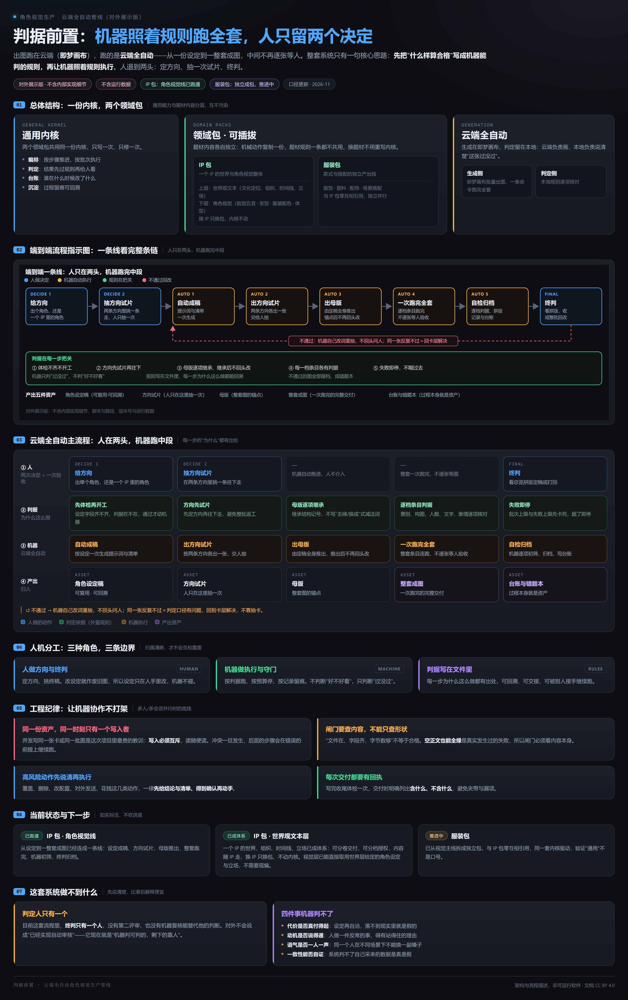

# 判据前置 · 云端全自动角色视觉生产管线

**一个把角色视觉生产变成流水线的 AIGC 系统：机器照着规则跑全套，人只留两个决定。**

> 这是架构与流程描述，不是可直接运行的软件。仓库里放的是流程、判据与产出样例。

---

## 先说结果

下面是这套管线跑出来的东西 —— 不是手绘、不是精修过的手工图，是「给一次方向 → 机器跑完中段 → 人只看拼版收货」的产出：

| 单角色 · 舞台定稿 | 同管线 · 走廊场景 |
|---|---|
|  |  |

同一个内核，换场景描述就换场景，角色锚点不飘。图上保留 AI 生成水印，因为这是 AI 出的图，没必要假装是别的东西。

---

## 它解决什么问题

用 AI 出图，一个人一天能出很多张。但真正做角色视觉时，卡的从来不是「出图速度」，是这三件事：

1. **一致性**：第 3 张和第 30 张还像同一个人吗？
2. **可追溯**：这张为什么长这样？改过哪些地方？上一版错在哪？
3. **可交付**：客户要的不是 20 张散图，是一份能验收的资产包。

只靠「写更好的提示词」解决不了这三个问题，因为提示词是一次性的，而项目是连续的。所以这套系统把重点从「怎么写提示词」挪到了 **「怎么让每一步都有判据、都有留档、都能被别人接手」**。

---

## 总体结构：一份内核，两个领域包

系统分成两层。**内核换题材不改**，**领域包换题材只换这个**。

### 通用内核（四件事）

| 组件 | 干什么 |
|---|---|
| **Orchestrator** | 按流程节点调度执行，决定下一步跑什么，什么条件下停 |
| **Judge** | 按预先写好的判据逐项检查，只判「过没过」，不判「好不好看」 |
| **Ledger** | 每次决定、每张图的去向都记账，任何一条产出都能回溯到当时的判断 |
| **Learn** | 失败样本自动进错题本，同类错不许犯第二次 |

这四件事和「角色」没有关系。画角色能用，画服装也能用，标一个别的题材也能用。

### 领域包（可插拔）

| 包 | 内容 | 状态 |
|---|---|---|
| **IP 角色包** | 角色锚点、镜头表、表情与动作档、场景库 | 已跑通 |
| **服装包** | 版型描述、面料与工艺词、款式矩阵、试衣场景 | 独立成包，推进中 |

「通用」不是自封的。它的硬标准是：**同一个内核 + 角色包**，和 **同一个内核 + 第二个领域包**，都能跑完一条完整产出线。第二个包就是用来证这件事的。

---

## 主流程：人在两头，机器跑中段



一条线看完整条链。蓝色的两处是人，橙色的五段是机器，绿色的判据贯穿全程，红色是不通过时的回改。

```
DECIDE 1  给方向        ── 人：单个角色，还是某个 IP 里的角色
DECIDE 2  抽方向试片    ── 人：两条方向里挑一条往下走（全流程里人只抽这一次）
AUTO 1    自动成稿      ── 提示词与清单一次生成
AUTO 2    出方向试片    ── 两条方向各出一张，交给人抽
AUTO 3    出母版        ── 由定稿全身推出锚点，锚定后不再回头改
AUTO 4    一次跑完全套  ── 逐档条目跑完，不逐张等人验收
AUTO 5    自检归档      ── 逐档判据检查、拼版、记录与台账
FINAL     终判          ── 人：看拼版，收，或整批回改
```

不通过的时候，**机器自己改词重抽，不回头问人**；同一张反复不过，说明是上游判据的问题，回卡层解决，而不是在出图层死磕。

### 判据在每一步把关

1. 体检不齐不开工
2. 方向先试片再往下
3. 母版逐项继承，继承后不回头改
4. 每一档条目各有判据
5. 失败即停，不糊过去

机器只判「过没过」，不判「好不好看」—— 好看是人的事。「过没过」必须写成文件，才能被机器执行，也才能被下一个人接手。

### 产出五件资产

角色设定稿（可复用、可回溯）· 方向试片（人只在这里抽一次）· 母版（整套图的锚点）· 整套成图（一次跑完的完整交付）· 台账与错题本（过程本身就是资产）

---

## 人机分工：三种角色，三条边界

| 角色 | 边界 |
|---|---|
| **人** | 决定方向、抽取试片、终判验收。**只有这三件，不多不少** |
| **机器** | 执行与守门。按规则跑，按判据查，不猜意图、不做审美判断 |
| **判据** | 写在文件里。每一条都必须可被机器检查、可被回溯、可被人接手复核 |

这个划分的价值不在于「省人力」，在于**责任清晰**：一张图出了问题，能立刻分清是方向错了（人）、还是没照着规则跑（机器）、还是规则本身写错了（判据）。

---

## 工程纪律：让机器协作不打架

一个项目一个判据集，全项目只有一个人有权改；改判据要留痕，改完要重跑受影响的下游。

**跨岗位要能跑，不是靠人情，是靠文件。** 新人接手时不需要问原作者，读到规则、读到台账、读到错题本，就能接着做。

**每次交付都要留痕**：交付物、判定记录、对应的判据版本、失败样本，四件一起归档。

---

## 当前状态与下一步

- **通用内核**：四件已成形，可复用
- **IP 角色包**：已跑通。角色锚点、镜头表、表情与动作档、场景库可复用
- **服装包**：已独立成包。版型、面料、款式矩阵推进中，验证内核可跨领域复用

下一步是把第二个领域包跑到和角色包同样的完成度 —— 那是「通用」这个说法唯一诚实的证明方式。

---

## 这套系统做不到什么

写清楚做不到的，比吹能做的重要。

- **判定人只有一个。** 美感、风格、能不能用，这些机器判不了。系统把人的判断压缩到两个决定 + 一次验收，但压不到零。
- **四件事机器判不了：** 方向对不对、风格合不合客户、能不能真的被市场接受、这张图该不该存在。
- **它不是一键出图的魔法。** 前端的方向判断和判据设计仍然要人写，写得差，后面跑得再顺也是错的方向。
- **出图质量取决于模型能力。** 这套系统管的是流程与一致性，管不了底层模型的上限。

---

## 授权

- **代码**（如导出脚本）：[MIT](LICENSE)
- **文档、架构图、流程图与文字说明**：[CC BY 4.0](LICENSE-docs) —— 可自由转载、演绎、商用，署名即可
- `assets/` 中的示例角色图为管线产出样例，版权归原作者所有

---

## 联系

陈世恒 · 浙江科技大学

如果这套流程对你有用，或者你想在自己的项目里跑一遍，欢迎开 issue 聊。
